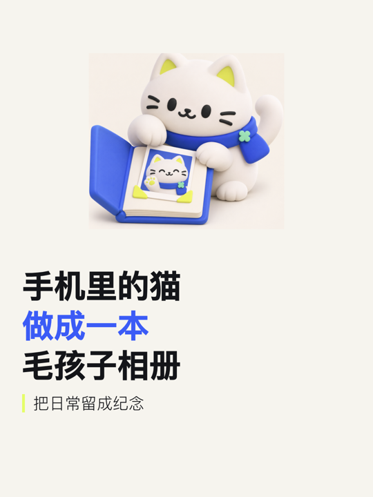

<div align="center">

# 封面海报生成器

**把一个主题，做成清爽的大字封面、海报与整套图文。**

中文 · [English](README.en.md)

[开始安装](docs/INSTALL.md) · [24 个案例](docs/GALLERY.md) · [配置字段](references/spec.md) · [使用方法](docs/USAGE.md)


</div>

给 Agent 一段内容，告诉它平台和尺寸，拿到可以直接使用的 PNG。

暖白底、黑蓝大字、黄色点缀。主视觉可以是 **3D 玩具风场景、你自己的图片，或内置图标**。标题与正文由模板排版，不把文字交给生图模型去画。

## 先看效果

这里有 **24 个实际制作的案例、34 张原尺寸 PNG**，覆盖 AI 办公、学习、旅行、宠物、美食、家居、简历、隐私、音乐与游戏等题材。包含三套完整图文、五种预设尺寸和自定义尺寸。

| AI 周报 · 5 页 | 宠物相册 · 3:4 | 旅行准备 · 4 页 |
| --- | --- | --- |
| [](docs/GALLERY.md#01-ai-weekly) | [](docs/GALLERY.md#04-pet) | [](docs/GALLERY.md#03-travel) |

| 公众号封面 · 2.35:1 | 视频封面 · 16:9 |
| --- | --- |
|  |  |

[打开完整案例库 →](docs/GALLERY.md) 每个案例都有原始材料、可复制话术、输入 JSON 和全部成品图。8 张 3D 主视觉也保留了原图与完整提示词。

## 一句话怎么用

```text
用封面海报生成器，把下面这段内容做成一套 3:4 图文。
封面用 3D 玩具风主视觉，内页每页回答一个问题。
只使用我给的事实，导出 PNG 和整套预览。

[在这里粘贴你的内容]
```

也可以直接说：

- 给这篇文章做一张公众号封面，标题分成两行。
- 做一张 16:9 视频封面，用我提供的产品截图。
- 不用生图，用内置图标做一张 1:1 方图。
- 第二页太长了，保留重点，拆成两页。

## 安装

克隆仓库后，选择你的 Agent：

```bash
git clone https://github.com/Jacobzhazha/social-cover-poster.git
cd social-cover-poster
python3 install.py --agent codex
```

| Agent | 安装方式 |
| --- | --- |
| Codex | `python3 install.py --agent codex` |
| Claude Code | `python3 install.py --agent claude-code` |
| Cursor | `python3 install.py --agent cursor` |
| GitHub Copilot | `python3 install.py --agent copilot` |
| Gemini CLI | `python3 install.py --agent gemini` |
| WorkBuddy | 从 [Releases](https://github.com/Jacobzhazha/social-cover-poster/releases) 下载技能包，在「技能 → 添加技能 → 上传技能」导入 |

安装脚本只复制技能运行需要的文件，**不会把整个案例图片库装进 Agent**，也不会覆盖已有同名技能。Windows 可将 `python3` 换为 `python`。

完整路径、项目内安装、生图能力与依赖配置见 [各 Agent 安装指南](docs/INSTALL.md)。

## 支持哪些输出

| 场景 | 配置 | 像素 |
| --- | --- | --- |
| 竖版封面 / 图文 | `3:4` | 1080 × 1440 |
| 方图 | `1:1` | 1080 × 1080 |
| 视频封面 | `16:9` | 1920 × 1080 |
| 公众号封面 | `2.35:1` | 1800 × 766 |
| 手机海报 | `9:16` | 1080 × 1920 |
| 自定义 | 如 `1242x1660` | 按配置输出 |

支持单张封面与多页图文；每次最多 18 页。内页每页最多 3 个要点、120 个可见字符。标题过长或内容溢出时，脚本给出具体修改位置。

## 不通过 Agent，也能出图

本地需要 Python 3.9+ 和可用的 Chromium / Chrome / Edge。推荐准备 Playwright：

```bash
python3 -m pip install -r requirements.txt
python3 -m playwright install chromium
python3 scripts/make_poster.py examples/14-resume.json --out output/resume
```

该示例使用内置图标，不需要生图账号。输出包含 PNG、`预览.html` 和网页源文件。生图模式由你所用 Agent 的图片工具负责，本仓库不内置图片模型或服务密钥。

## 文件怎么找

```text
SKILL.md        Agent 读取的技能说明
scripts/        检查、排版、PNG 导出与内置图标
templates/      固定版式与浏览器布局检查
references/     字段规范、文案规则与简短配置示例
examples/       24 个案例的输入 JSON 与制作材料
assets/         案例成品、预览图与生图原图
docs/           双语安装、使用与完整案例库
```

## 作者

**Jacobzhazha · 渣渣的赛博宇宙**

分享 AI 实用技巧、工具实测与开源 Skills。在微信搜索公众号「渣渣的赛博宇宙」。

[反馈问题](https://github.com/Jacobzhazha/social-cover-poster/issues) · [参与改进](CONTRIBUTING.md) · [MIT License](LICENSE)
