# Example gallery

[中文](GALLERY.md) · [Home](../README.en.md)

24 cases · 34 exported PNGs. Click an image to open the original.

[Source material and reusable requests](../examples/materials.json) · [Full image prompts](../examples/image-prompts.json)

## 01 · AI weekly workflow

**1080 × 1440 · 5 page(s)**

[JSON](../examples/01-ai-weekly.json)

Reuse the JSON input and replace its titles and points with your own source material.

[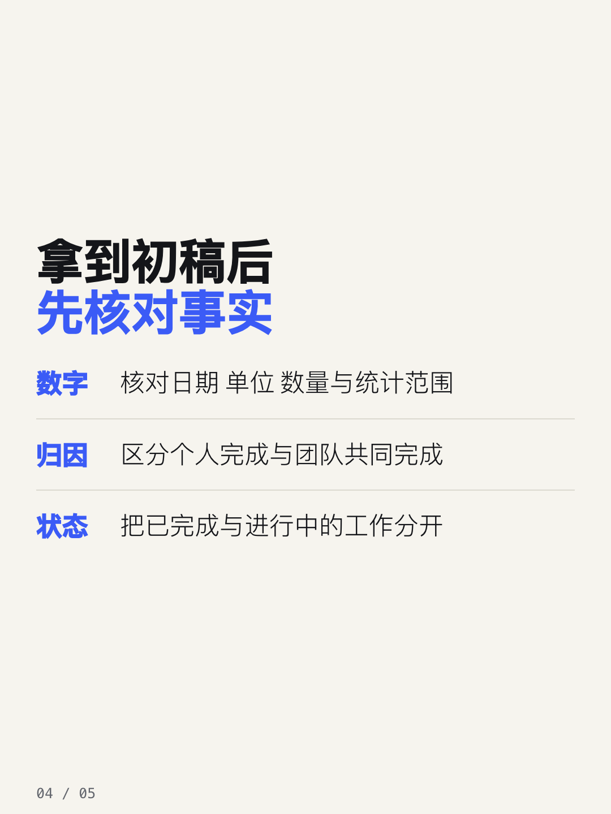](../assets/examples/01-ai-weekly-04.png)

[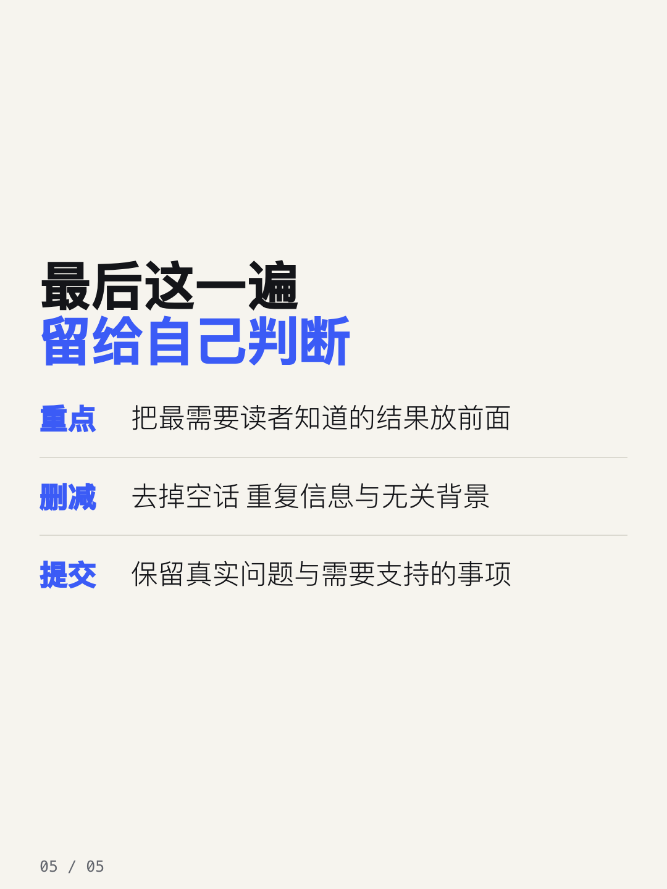](../assets/examples/01-ai-weekly-05.png)

## 02 · Weekend coffee

**1080 × 1080 · 1 page(s)**

[JSON](../examples/02-coffee.json)

Reuse the JSON input and replace its titles and points with your own source material.

## 03 · Travel checklist

**1080 × 1920 · 4 page(s)**

[JSON](../examples/03-travel.json)

Reuse the JSON input and replace its titles and points with your own source material.

[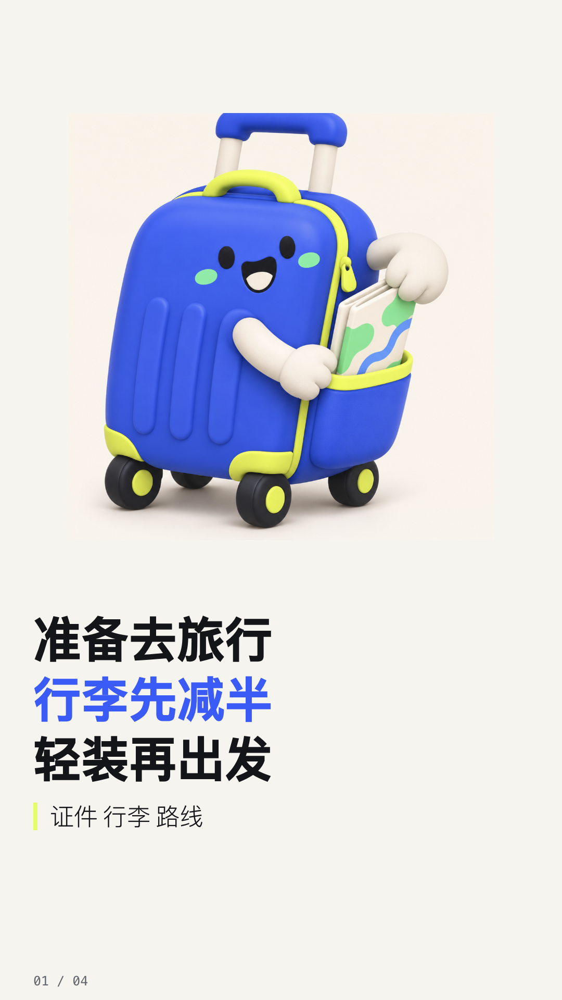](../assets/examples/03-travel-01.png)

[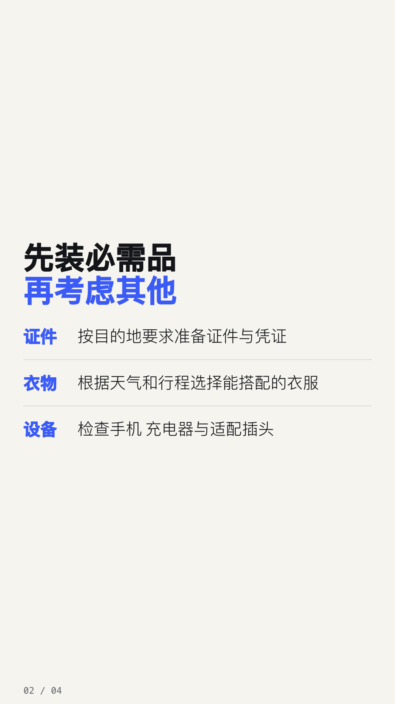](../assets/examples/03-travel-02.png)

[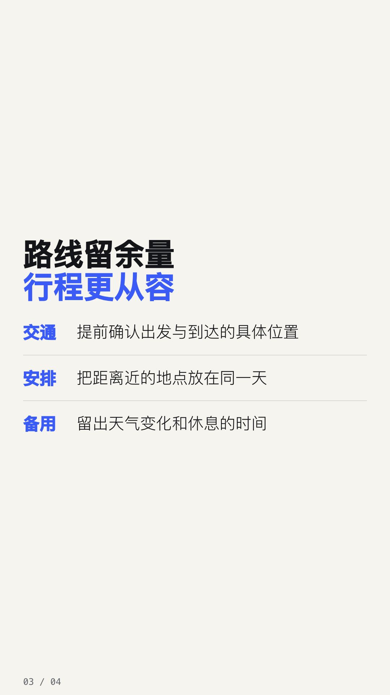](../assets/examples/03-travel-03.png)

[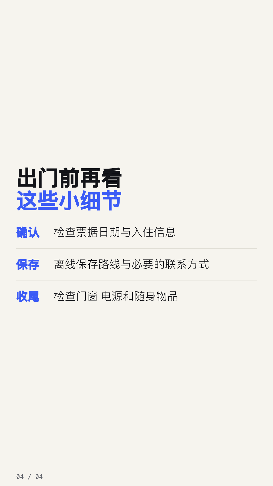](../assets/examples/03-travel-04.png)

## 04 · Pet photo album

**1080 × 1440 · 1 page(s)**

[JSON](../examples/04-pet.json)

Reuse the JSON input and replace its titles and points with your own source material.

## 05 · Study planner

**1080 × 1440 · 1 page(s)**

[JSON](../examples/05-study.json)

Reuse the JSON input and replace its titles and points with your own source material.

[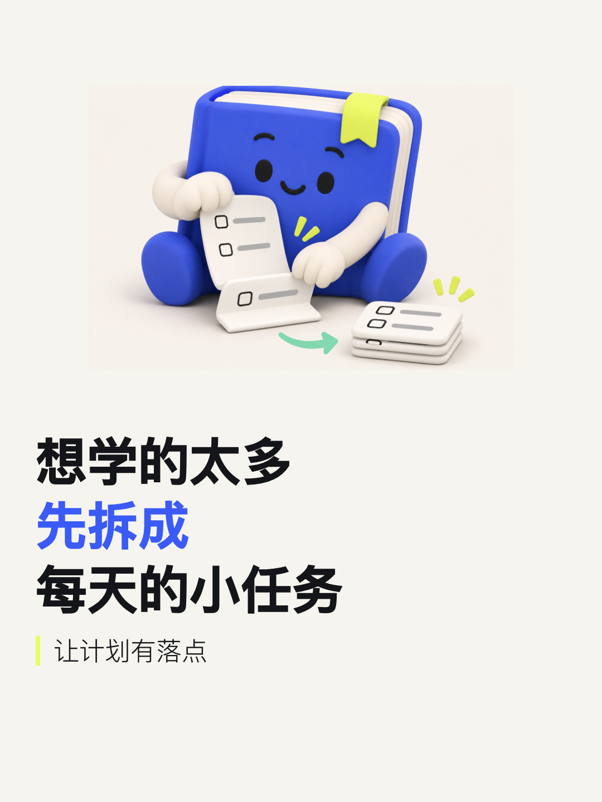](../assets/examples/05-study-01.png)

## 06 · Organized desk

**1800 × 766 · 1 page(s)**

[JSON](../examples/06-desk.json)

Reuse the JSON input and replace its titles and points with your own source material.

[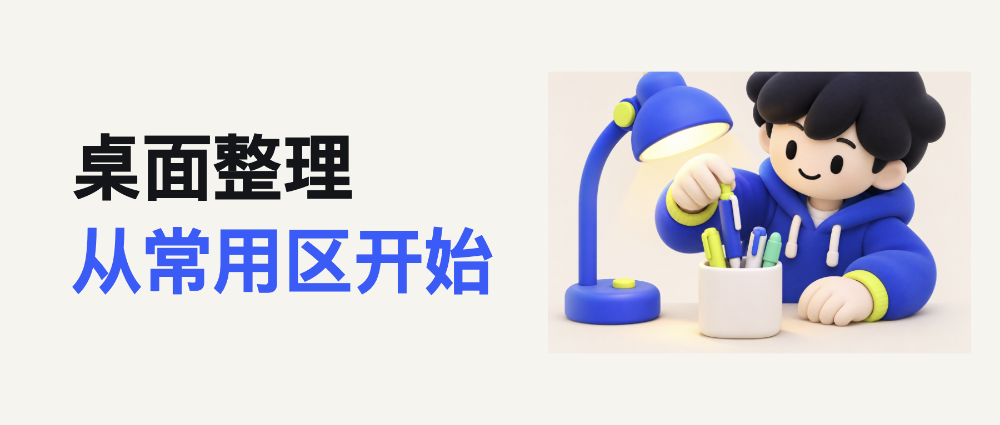](../assets/examples/06-desk-01.png)

## 07 · Video editing

**1920 × 1080 · 1 page(s)**

[JSON](../examples/07-video.json)

Reuse the JSON input and replace its titles and points with your own source material.

## 08 · Growing a habit

**1080 × 1080 · 1 page(s)**

[JSON](../examples/08-plant.json)

Reuse the JSON input and replace its titles and points with your own source material.

## 09 · Agent skills

**1800 × 766 · 1 page(s)**

[JSON](../examples/09-skills.json)

Reuse the JSON input and replace its titles and points with your own source material.

## 10 · Podcast notes

**1920 × 1080 · 1 page(s)**

[JSON](../examples/10-podcast.json)

Reuse the JSON input and replace its titles and points with your own source material.

## 11 · Reading notes

**1080 × 1440 · 4 page(s)**

[JSON](../examples/11-reading.json)

Reuse the JSON input and replace its titles and points with your own source material.

[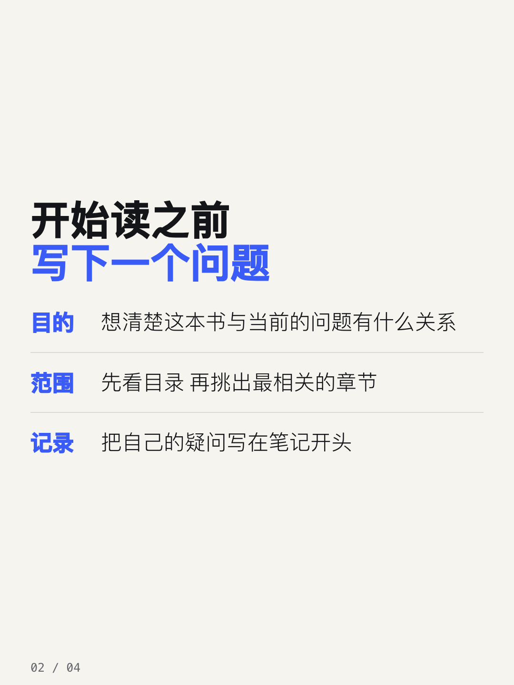](../assets/examples/11-reading-02.png)

[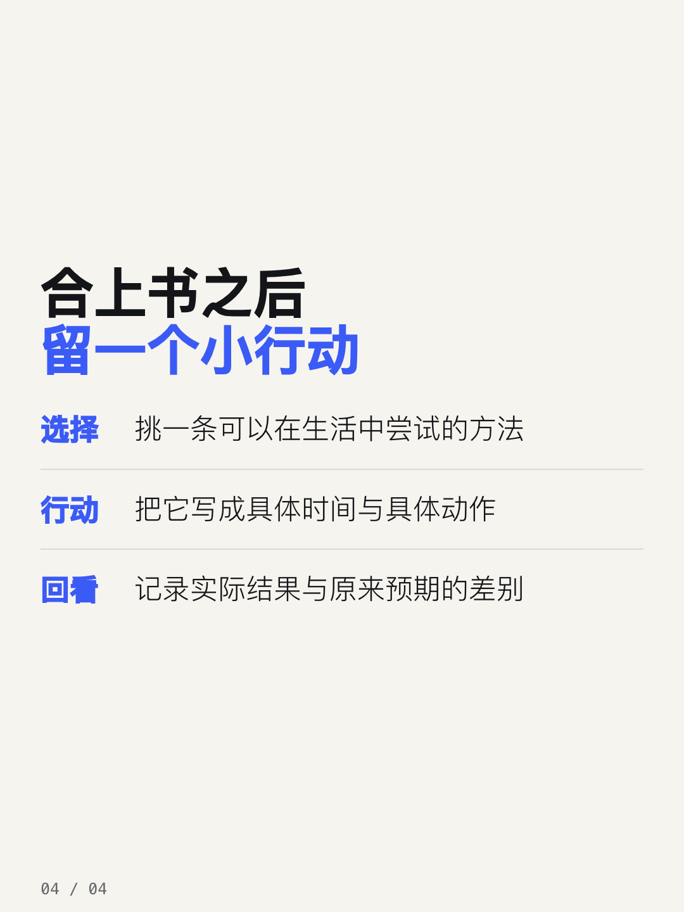](../assets/examples/11-reading-04.png)

## 12 · Creative workshop

**1080 × 1920 · 1 page(s)**

[JSON](../examples/12-workshop.json)

Reuse the JSON input and replace its titles and points with your own source material.

## 13 · Home cooking

**1080 × 1080 · 1 page(s)**

[JSON](../examples/13-recipe.json)

Reuse the JSON input and replace its titles and points with your own source material.

## 14 · Resume writing

**1080 × 1440 · 1 page(s)**

[JSON](../examples/14-resume.json)

Reuse the JSON input and replace its titles and points with your own source material.

[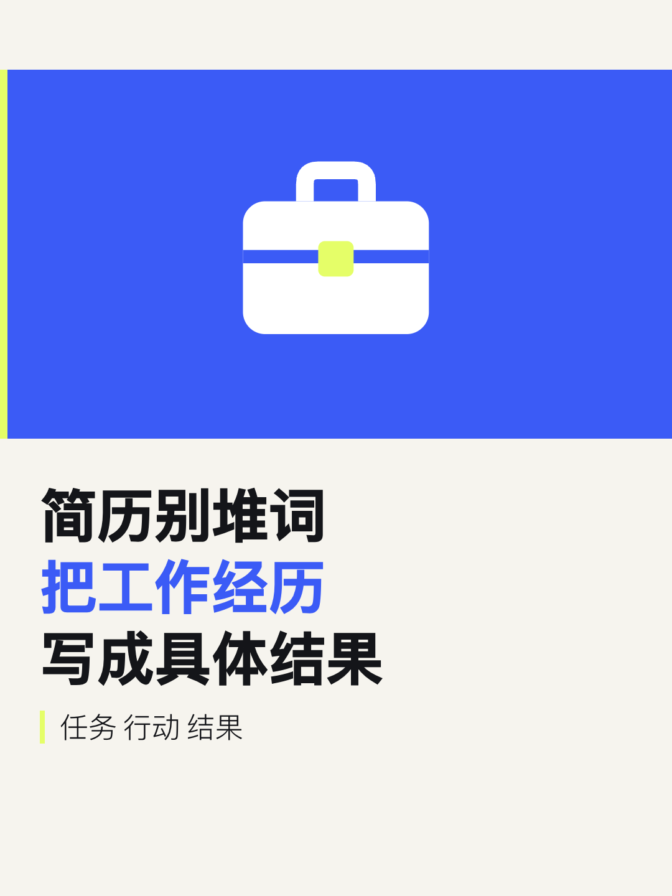](../assets/examples/14-resume-01.png)

## 15 · Privacy basics

**1920 × 1080 · 1 page(s)**

[JSON](../examples/15-privacy.json)

Reuse the JSON input and replace its titles and points with your own source material.

## 16 · Weekly planning

**1080 × 1920 · 1 page(s)**

[JSON](../examples/16-calendar.json)

Reuse the JSON input and replace its titles and points with your own source material.

## 17 · Shopping checklist

**1080 × 1440 · 1 page(s)**

[JSON](../examples/17-shopping.json)

Reuse the JSON input and replace its titles and points with your own source material.

[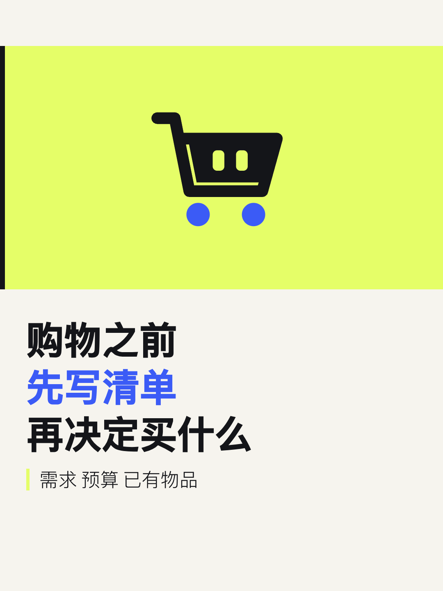](../assets/examples/17-shopping-01.png)

## 18 · Existing image layout

**1242 × 1660 · 1 page(s)**

[JSON](../examples/18-image-input.json)

Reuse the JSON input and replace its titles and points with your own source material.

[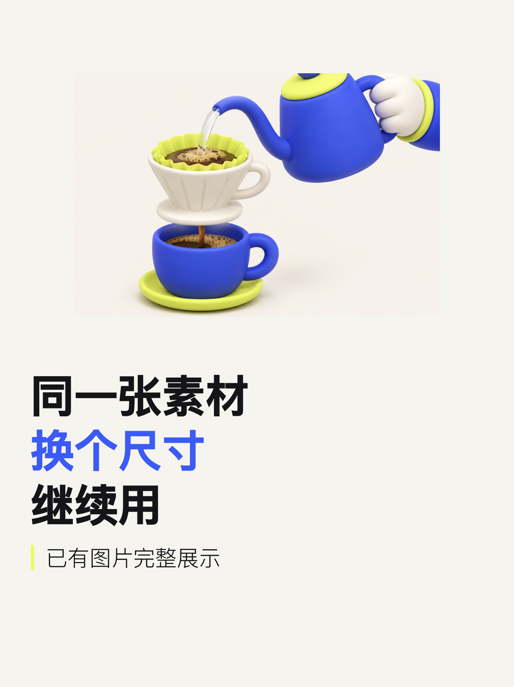](../assets/examples/18-image-input-01.png)

## 19 · Typography only

**1080 × 1080 · 1 page(s)**

[JSON](../examples/19-type-only.json)

Reuse the JSON input and replace its titles and points with your own source material.

## 20 · English cover

**1920 × 1080 · 1 page(s)**

[JSON](../examples/20-english.json)

Reuse the JSON input and replace its titles and points with your own source material.

[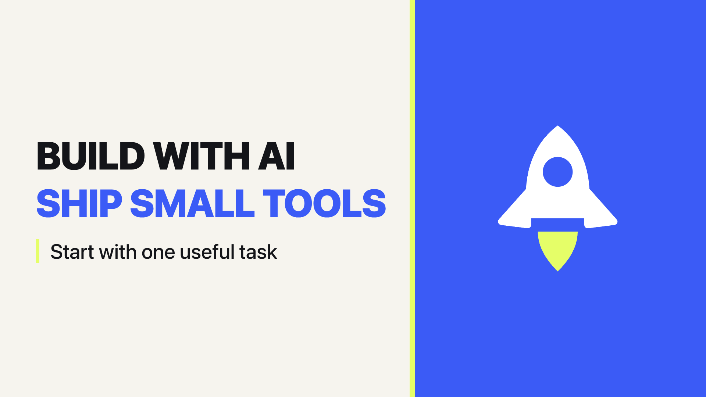](../assets/examples/20-english-01.png)

## 21 · Movement routine

**1080 × 1440 · 1 page(s)**

[JSON](../examples/21-fitness.json)

Reuse the JSON input and replace its titles and points with your own source material.

[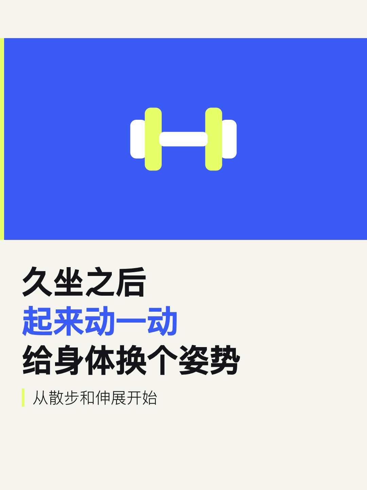](../assets/examples/21-fitness-01.png)

## 22 · Focus playlist

**1080 × 1080 · 1 page(s)**

[JSON](../examples/22-music.json)

Reuse the JSON input and replace its titles and points with your own source material.

[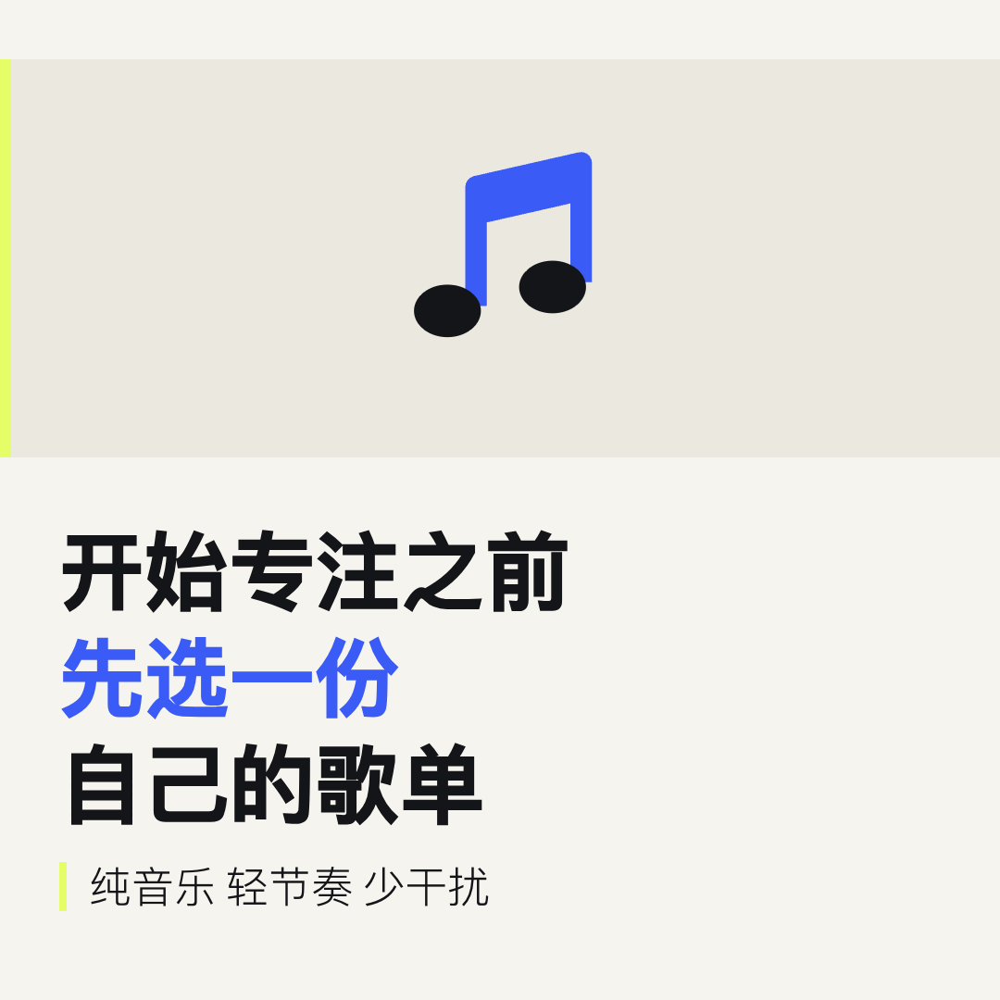](../assets/examples/22-music-01.png)

## 23 · Family photo collection

**1080 × 1440 · 1 page(s)**

[JSON](../examples/23-family.json)

Reuse the JSON input and replace its titles and points with your own source material.

## 24 · Game design notes

**1920 × 1080 · 1 page(s)**

[JSON](../examples/24-game.json)

Reuse the JSON input and replace its titles and points with your own source material.

